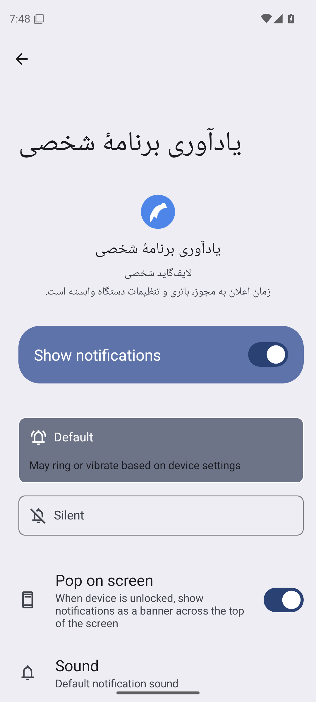

# پذیرش تنظیمات Android موفق؛ تحویل APK همچنان مسدود

PR42 بر `fix/personal-notification-controls` /76efe36 فقط ابزار آزمون و مستندات را توسعه می‌دهد. منبع اجرایی آزموده‌شده `1b7ab09b1a9d4b93b39cbba34a962d2f2cf03dac` است. Flutter محصول، Kotlin، SQLite محصول، امضا، نسخه، مجوزها و قفل upload تغییر نکردند. آماده‌سازی مسیر حفظ داده در PR43 جداست؛ این PR انتقال داده را پیاده یا اجرا نمی‌کند.

**VERIFIED:** گام پذیرش واقعی API35 در [اجرای شخصی39663527908](https://github.com/davoodmehraban89/LifeMate/actions/runs/39663527908) موفق شد: صفحهٔ کانال ثابت Android، برگشت، حفظ OFF/صفر اعلان و SQL مستقل پس از بازگشایی. کل workflow پس از این موفقیت در گیت سازگاری APK شکست خورد؛ پذیرش OS با تحویل APK یک نتیجه نیست. [گواه CI و تاریخچهٔ تلاش‌ها](evidence/personal-native-settings-ci-2026-10-21.json)، [receipt خامِ پاک‌سازی‌شدهٔ PASS](evidence/personal-native-settings-pass-2026-10-21.json).

## کاری که آزمون بررسی می‌کند

پس از سناریوی موجودِ SQLite واقعی، اعلان پس از نبود پردازش، لغو و OFF، fixture هرگز توزیع‌نشده متد واقعی `openNotificationSettings` را صدا می‌زند. میزبان با UIAutomator بررسی می‌کند عنوان کانال ثابت روی node متعلق به `com.android.settings` باشد؛ عنوان مشابه از app دیگر، XML نامعتبر/بزرگ یا صفحهٔ دیگر پذیرفته نمی‌شود. سپس Android Back، بستن/بازگشایی، SQL مستقل و وضعیت native بررسی می‌شوند: انتخاب OFF حفظ، اعلان جدید صفر و دادهٔ ساختگی موجود برقرار باشد.

هیچ reset/uninstall، انتخاب ضمنی دستگاه، ورودی دادهٔ واقعی یا نوشتن DB محصول اضافه نشده است. گیت‌های fresh API35 emulator، serial صریح، دو APK هم‌امضا و نبود بستهٔ قبلی حفظ شدند. XML فایل تصادفی متعلق به همین AVD خوانده و در finally حذف می‌شود؛ XML/DB خام روی میزبان یا در artifact منتشر نمی‌شود. خروجی فقط assertion، bool/count و تصویر صفحهٔ همین شبیه‌ساز ساختگی است. توضیح طراحی در [برنامهٔ آزمون](../superpowers/plans/2026-10-21-personal-native-settings-acceptance.md).

## VERIFIED محلی

[گواه دستور/خروجی](evidence/personal-native-settings-2026-10-21.json): baseline35، RED4 شکستِ نبود بررسی، GREEN39 تست مرتبط و64 تست کل ابزار، Flutter332، analyze بدون مشکل و format1/0تغییر. تست‌های host از مدل Android برای بررسی orchestration استفاده می‌کنند؛ این مدل اجرای OS نیست. بازبین مستقل ایراد مسدودکننده‌ای در حفظ گیت‌ها/DB/رضایت پیدا نکرد؛ خودش تست native اجرا نکرد.

## UNVERIFIED و مانع تحویل

اجرای سناریوی جدید در API35 **VERIFIED** است؛ صدای شنیدنی، انتخاب صدای واقعی، OEM fallback، گوشی/Doze/reboot و حفظ دادهٔ **APK دقیق تحویلی قبلی → نامزد جدید در DB محصول** همچنان **UNVERIFIED** هستند. این آزمون نصب تازهٔ متعلق به تست و DB جدا دارد؛ ارتقای همان نصب موجود کاربر را اثبات نمی‌کند.

گیت همین اجرای شخصی39663527908 دقیقاً با `certificate_mismatch` و `version_code_not_incremented` مقدار BLOCKED داد؛ `deliveryReasonCode=default_database_upgrade_acceptance_missing` نیز حفظ شد. [receipt انسداد](evidence/personal-native-settings-update-blocked-2026-10-21.json). PR41/39545684895 هم پس از پذیرش OS در همین گیت شکست خورده بود. [قفل تحویل](../operations/PERSONAL_UPDATE_GUARD.md) همچنان بسته است؛ هیچ APK تازه‌ای به‌عنوان آپدیت امن تحویل نشده و نصب موجود نباید حذف یا clear-data شود.

بررسی نام‌های secrets در GitHub با403integration رد شد؛ فقط فهرست cacheها قابل خواندن بود. جست‌وجوی محلی فقط دو کپی fixture عمومی SDK با نام debug.keystore یافت؛ محتوای کلید خوانده نشد. این مشاهدات، نبود کلید اصلی نزد مالک را اثبات نمی‌کنند. وضعیت آن هنوز **UNVERIFIED** است. برای حل اختلاف امضا، برنامهٔ نصب‌شده حذف یا clear-data نشود.

## شکست واقعی و آزمایش تشخیصی بعدی

CI39660443764 روی48940b3 در `native_notification_settings` با `notification_settings_screen_not_verified` شکست خورد؛ guard این بار اجرا نشد. [receipt شکست](evidence/personal-native-settings-failed-2026-10-21.json) حفظ شد. بررسی‌های قبل از آن، SQLite/close-reopen، اعلان واقعی پس از نبود پردازش، تغییر/تیک/لغو و OFF را پاس کردند. CIعمومی39660443665 نیز332Flutter/308Backend و analyze را پاس کرد.

آن اجرای ناموفق فاقد شواهد UI بود؛ علت فردی آن از receipt اول قابل اثبات نیست و شکست اصلی حفظ شده است. followup فقط Python، `/dev/tty` را با فایل تصادفی متعلق به همان AVD مقایسه کرد؛ predicate عنوان دقیق و package سیستمی روی همان node ضعیف نشد.

RED2 قبل از تشخیص فایل و RED1 برای نبود probe پایانی ثبت شدند؛ پس از تغییر،66تست ابزار موفق شدند. این‌ها host هستند؛ نتیجهٔ Android جدا با receipt واقعی زیر ثابت شد. Flutter/analyze محلی برای followup صرفاً Python تکرار نشدند؛ CI روی1b7ab09 واقعاً332تست Flutter و analyze را گذراند.

## مشاهدهٔ سه‌گانه و تصویر واقعی شبیه‌ساز

| مشاهده | تعداد کاراکتر | XML معتبر | package تنظیمات | عنوان کانال | تأیید همان node |
|---|---:|---|---|---|---|
| legacyTty | 33 | false | false | false | false |
| file | 18134 | true | true | true | true |
| legacyTtyAfterFile | 33 | false | false | false | false |

پس از تأیید صفحه با فایل، probe قدیمی باز هم سلسله‌مراتب نداد؛ تفاوت مشاهده به آماده‌نبودن اولیهٔ UI نسبت داده نمی‌شود. این نتیجه محدودیت مسیر مشاهدهٔ TTY را در همین AVD نشان می‌دهد؛ متن خام33کاراکتری منتشر نشده و علت عمومی PTY/OEM یا گوشی ادعا نمی‌شود. `nativeNotificationSettingsWhileOff` و `sqliteAfterNotificationSettings` هر دو PASS هستند. هماهنگ‌کننده PNG را مستقل دید و صفحهٔ کانال ثابت را تأیید کرد.

artifact صرفاً verification با ID12375074129 فاقد APK بود؛ SHA256 ZIP برابر `57ae4403d0a010c5836d9dabb4f5a7966bcbd806f0465ab4d1f8eb131a2385c8` با metadata رسمی تطبیق یافت. SHA256 PNG برابر `43729cd8ca25bade742785bf042206cca84481265cf6ead0e42c885529c1fe80` با receipt برابر است. receiptها از اتصال رسمی GitHub و logها با gh خوانده شدند؛ APK، XML خام، secret یا URL موقت دانلود ثبت نشد.

## CI عمومی؛ شکست اول محفوظ، retry موفق

تلاش اول [39663527874 روی1b7ab09](https://github.com/davoodmehraban89/LifeMate/actions/runs/39663527874/attempts/1) در ساخت APK عادی شکست خورد: آماده‌سازی `NDK28.2.13676358` پیام `Error on ZipFile unknown archive` داد؛ sdkmanager/assembleDebug با exit1 تمام شدند. پیش از آن Flutter332، Backend308، role41، regression96، TLS5، worker4، analyze clean و audit0 موفق بودند. علت عمیق‌تر خرابی archive از این پیام حدس زده نمی‌شود.

هماهنگ‌کننده فقط job ناموفق Flutter را با `gh run rerun 39663527874 --failed` تکرار کرد؛ backend/security موفق قبلی حفظ شدند. [تلاش دوم](https://github.com/davoodmehraban89/LifeMate/actions/runs/39663527874/attempts/2) واقعاً **SUCCESS** شد: Flutter332، worker4، analyze clean، buildوب/Android، manifest PASS و امضایdebug/v2 موفق؛ هر سه job وضعیت موفق دارند. NDK این بار نصب شد؛ علت شکست archive تلاش اول فراتر از پیام ثبت‌شده معلوم نیست و حذف نشده است. artifactهای عمومی فقط metadata خوانده شدند؛ APK دریافت نشد. هیچ rerun دیگری، merge/deploy، تغییر گیت یا انتقال دادهٔ واقعی توسط عامل شواهد انجام نشد.
